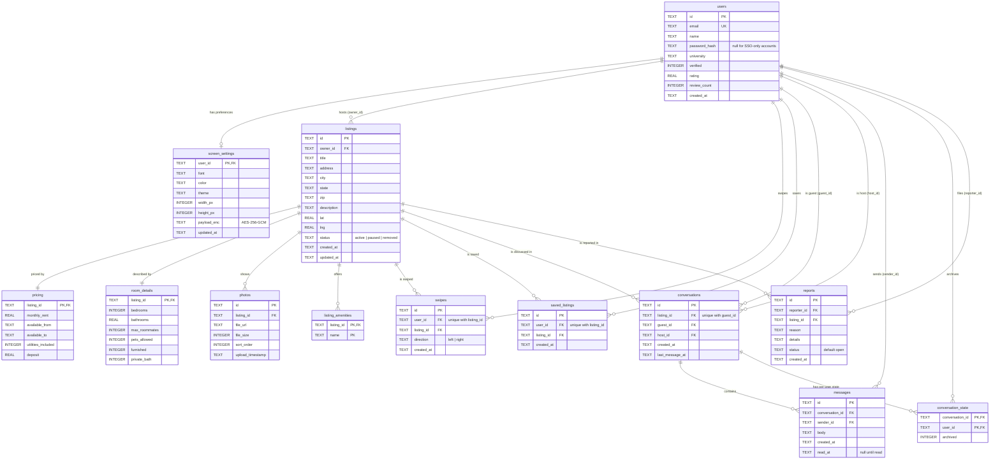

# SubletU data model (ERD)

This is the database behind the class diagram (`Class Diagram1.pdf`). The
source of truth for every column is `server/src/db.ts`; this page shows the
keys and relationships and records the decisions behind them.

GitHub renders the diagram below. A PNG export for slides is in
[`erd.png`](erd.png).

Key: **PK** primary key, **FK** foreign key, **UK** unique. Two **PK** marks in
one table mean a composite primary key. A crow's foot means "many".

## Every class-diagram entity, and where it lives

| Class               | Table                          | How it maps                                                                                                                                      |
|---------------------|--------------------------------|--------------------------------------------------------------------------------------------------------------------------------------------------|
| `Data` (abstract)   | none                           | Abstract base with no fields of its own. Each concrete subclass gets its own table (table-per-concrete-class).                                    |
| `ListingData`       | `listings`, `listing_amenities` | One row per listing. Amenities are a multi-valued attribute, so they get their own table keyed by `(listing_id, name)`.                         |
| `PricingData`       | `pricing`                      | Composition, 1 to 1. `listing_id` is both the primary key and the foreign key, so a listing can never have two pricing rows.                     |
| `RoomDetails`       | `room_details`                 | Composition, 1 to 1, same shared-key pattern as `pricing`.                                                                                       |
| `PhotoData`         | `photos`                       | Composition, 1 to many. `sort_order` keeps the host's photo order.                                                                                |
| `ScreenSettings`    | `screen_settings`              | 1 to 1 with `users`. Display fields are plain columns; the private preferences are encrypted into `payload_enc` (`EncryptData()` / `DecryptData()`). |
| `ListingManager`    | none                           | A service class. Its fields (`listing`, `operationStatus`) only exist while one request is being handled, so nothing is stored.                  |
| `Screen`            | none                           | UI class, implemented as React components. Its `screenSettings` field reads from `screen_settings`.                                               |
| `PostListingScreen` | none                           | UI class (`web/src/screens/Post.tsx`). `submissionStatus` and `uploadProgress` are front-end state; a submitted listing is written through `ListingManager`. |

The class diagram has no `User` class, but `listings.owner_id` needs
something to point at, so `users` is added here. The remaining tables
(`swipes`, `saved_listings`, `conversations`, `messages`,
`conversation_state`, `reports`) come from the use cases rather than the
class diagram. A few columns exist in the tables but not yet in the diagram:
`pricing.deposit`, `room_details.furnished`, `room_details.private_bath`, and
`listings.lat` / `lng`. Adding a `User` class and those attributes to the
class diagram would bring the two back in line.

## Soft-delete decision for listings

**Decision: listings are never hard-deleted.** Deleting a listing sets
`listings.status = 'removed'` and leaves the row in place.

**Why.** `conversations`, `messages` and `reports` all reference `listings`
with `ON DELETE CASCADE`. A real `DELETE` would erase the chat history of
both the host and the renter, and it would erase every report filed against
the listing. That second point matters most: a scammer could delete their
listing and take the evidence with it.

**Status values.** `active` (shown to renters), `paused` (hidden by the
host, can be reactivated), `removed` (deleted). `ListingData.validateData()`
rejects any other value.

**One way in, no way back.** Only `DELETE /api/listings/:id`
(`ListingManager.deleteListing()`) can set `removed`: `PATCH /api/listings/:id`
accepts only `active` or `paused`. Once removed, a listing cannot be edited or
reactivated: `ListingManager.updateListing()` treats a removed listing as not
found, so `PATCH` returns 404.

**What happens to related rows when a listing is removed**

| Table                                        | What happens | Why                                                        |
|----------------------------------------------|--------------|------------------------------------------------------------|
| `photos`                                     | deleted      | Files take disk space and no one can open the listing.     |
| `saved_listings`                             | deleted      | A renter's saved list should not show a dead listing.      |
| `conversations`, `messages`                  | kept         | Both parties keep their chat history.                      |
| `reports`                                    | kept         | Moderation evidence survives the host deleting the listing. |
| `swipes`                                     | kept         | Harmless: the deck only ever shows active listings.        |
| `pricing`, `room_details`, `listing_amenities` | kept       | Part of the listing row they belong to.                    |

**Read paths.** Every query that shows listings to people filters removed
rows out: the deck and search default to `status = 'active'`, and
`GET /listings/:id`, saving, swiping and starting a conversation all return
404 for a removed listing.

**Open points**

- The status values are enforced in application code only. A
  `CHECK (status IN ('active','paused','removed'))` on `listings` would let
  the database enforce them too.
- `users` → `listings` is still `ON DELETE CASCADE`. There is no
  account-deletion endpoint today; if one is added, it needs its own
  soft-delete decision, or deleting a host would hard-delete their listings
  and every report against them.

## Supporting tables not shown

These exist for sign-in and infrastructure and do not correspond to any
class: `oauth_states`, `sso_handoffs`, `email_verification_codes`,
`password_reset_tokens` and `auth_attempts` (all reference `users` or are
keyed by email/IP), and `geocache` (Nominatim results, keyed by query
string). See `server/src/db.ts` for their columns.
